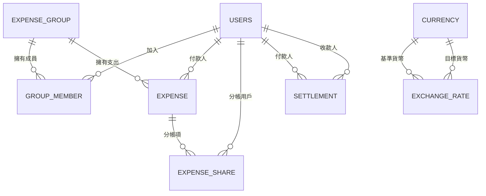

# 執行摘要  
設計「多幣種線上分帳」系統時，我們以**群組（Group）**為單位，每個群組設定一個「基準貨幣」（Home Currency）。所有記帳都同時記錄**原始幣別金額**和**基準幣別金額**，並在交易時鎖定當時匯率。如此一來，歷史報表的計算就能保持穩定正確。設計的主要實體包括：用戶（User）、群組（ExpenseGroup）、群組成員（GroupMember）、支出（Expense）、分帳項（ExpenseShare）、還款（Settlement）、貨幣（Currency）與匯率（ExchangeRate）等表格。各表定義主鍵、外鍵、欄位型別和約束，並儲存示例資料以便說明。關聯上，用戶和群組間透過成員表建立多對多關係，支出與分帳、一對多；還款在用戶間一對一對應等。此外，本方案建議建立必要索引，以支援群組餘額查詢、用戶淨額、支出搜尋、匯率查詢等常見查詢模式；並採用交易和鎖機制確保一致性（如在 JPA 實體中使用 `@Version` 標註實現樂觀鎖）。我們會提供PostgreSQL與SQL Server的 DDL 範例、常用 SQL 查詢範例、REST API 設計示例以及遷移（Flyway）建議等，並比較多種設計抉擇（例如即時計算 vs 預存餘額、即時匯率 vs 歷史匯率）以供參考。  

## 實體與欄位 (Tables & Columns)  
- **`users` (用戶)**  
  - `id`：UUID 或 BIGSERIAL，主鍵(PK)；非 NULL。  
  - `name`：VARCHAR，不可為空，用戶名稱。  
  - `email`：VARCHAR，不可為空，且需唯一(UNIQUE)；用戶帳號。  
  - `password`：VARCHAR，不可為空，儲存密碼雜湊值。  
  - `avatar_url`：VARCHAR，可為 NULL，使用者頭像 URL。  
  - `created_at`：TIMESTAMP，不可為空，預設 CURRENT_TIMESTAMP。  
  - **示例**：`(id='a1b2c3d4', name='Alice', email='alice@example.com', password='...', created_at=...)`。  

- **`expense_group` (群組)**  
  - `id`：UUID 主鍵。  
  - `name`：VARCHAR，不可為空，群組名稱。  
  - `description`：TEXT，可為 NULL，群組描述。  
  - `owner_id`：UUID，外鍵(FK)指向 `users(id)`，群主帳號。  
  - `base_currency`：CHAR(3)，外鍵指向 `currency(code)`，群組的基準貨幣（如「TWD」）。  
  - `created_at`：TIMESTAMP，不可為空，預設現在時間。  
  - **示例**：`(id='g123', name='Japan Trip', owner_id='a1b2c3d4', base_currency='TWD', created_at=2023-07-19)`.  

- **`group_member` (群組成員)**  
  - `id`：BIGSERIAL 主鍵。  
  - `group_id`：UUID，FK 指向 `expense_group(id)`。  
  - `user_id`：UUID，FK 指向 `users(id)`。  
  - `role`：VARCHAR(16)，成員角色 (如 OWNER、MEMBER)。  
  - `joined_at`：TIMESTAMP，加入時間。  
  - UNIQUE 約束：`(group_id, user_id)`，同一群組不可重複加入同一用戶。  
  - **示例**：`(id=1, group_id='g123', user_id='a1b2c3d4', role='OWNER', joined_at=2023-07-18)`.  

- **`expense` (支出)**  
  - `id`：BIGSERIAL 主鍵。  
  - `group_id`：UUID，FK 指向 `expense_group(id)`。  
  - `payer_id`：UUID，FK 指向 `users(id)`，付款人。  
  - `title`：VARCHAR，不可為空，支出標題。  
  - `category_id`：INT (或 BIGSERIAL)，FK 指向 `expense_category(id)` (分類，可選表)。  
  - `currency`：CHAR(3)，外鍵指向 `currency(code)`，原始幣別（如「USD」）。  
  - `amount`：DECIMAL(20,2) 或 NUMERIC，原始金額；**不使用浮點**以免精度問題。  
  - `exchange_rate`：DECIMAL(12,6)，交易日匯率 (1 原幣 = ? 基幣)。  
  - `base_amount`：DECIMAL(20,2)，原幣換算後的基準貨幣金額 (amount * exchange_rate)。  
  - `expense_date`：DATE，不可為空，發生日期。  
  - `note`：TEXT，可為 NULL，備註。  
  - `created_at`：TIMESTAMP，不可為空，預設。  
  - **示例**：`(id=101, group_id='g123', payer_id='a1b2c3d4', title='Dinner', currency='JPY', amount=12000.00, exchange_rate=0.2050, base_amount=2460.00, expense_date=2023-07-18)`.  

- **`expense_share` (分帳項)**  
  - `id`：BIGSERIAL 主鍵。  
  - `expense_id`：BIGINT，FK 指向 `expense(id)`。  
  - `user_id`：UUID，FK 指向 `users(id)`，分帳對象。  
  - `share_amount`：DECIMAL(20,2)，此用戶應分擔的基準貨幣金額。  
  - `paid_amount`：DECIMAL(20,2)，此用戶已支付的金額。  
  - `status`：VARCHAR(16)，狀態 (例如 OWING、PAID)。  
  - UNIQUE 約束：`(expense_id, user_id)`，同一支出中同一用戶只出現一次。  
  - **示例**：`(id=201, expense_id=101, user_id='b2c3d4e5', share_amount=820.00, paid_amount=0.00, status='OWING')`.  

- **`settlement` (還款交易)**  
  - `id`：BIGSERIAL 主鍵。  
  - `group_id`：UUID，FK 指向 `expense_group(id)`。  
  - `from_user`：UUID，FK 指向 `users(id)`，付款人。  
  - `to_user`：UUID，FK 指向 `users(id)`，收款人。  
  - `amount`：DECIMAL(20,2)，支付金額，以基準貨幣計。  
  - `currency`：CHAR(3)，支付幣別 (通常為群組基準貨幣)。  
  - `settled_at`：TIMESTAMP，支付時間。  
  - **示例**：`(id=301, group_id='g123', from_user='b2c3d4e5', to_user='a1b2c3d4', amount=820.00, currency='TWD', settled_at=2023-07-19)`.  

- **`currency` (貨幣)**  
  - `code`：CHAR(3)，主鍵，ISO 貨幣代碼（如 TWD, USD）。  
  - `name`：VARCHAR，不可為空，貨幣名稱。  
  - `symbol`：VARCHAR(8)，貨幣符號（如 $）。  
  - `decimal_places`：INT，不可為空，小數位數 (e.g. 2)。  
  - **示例**：`(code='TWD', name='新台幣', symbol='NT$', decimal_places=2)`.  

- **`exchange_rate` (匯率歷史)**  
  - `id`：BIGSERIAL 主鍵。  
  - `base_currency`：CHAR(3)，FK 指向 `currency(code)`。  
  - `target_currency`：CHAR(3)，FK 指向 `currency(code)`。  
  - `rate`：DECIMAL(18,6)，匯率值 (1 base = rate target)。  
  - `effective_date`：DATE，不可為空，生效日期。  
  - `source`：VARCHAR(32)，匯率來源 (如 API 名稱)。  
  - `updated_at`：TIMESTAMP，不可為空，自動更新。  
  - UNIQUE 約束：`(base_currency, target_currency, effective_date)`，一天一筆。  
  - **示例**：`(id=401, base_currency='USD', target_currency='TWD', rate=30.8500, effective_date=2023-07-18, source='exchangerate.host')`.  

- （可選）**`expense_category` (支出分類)**：例如 `id`, `name`（分類名稱）。同一群組可共用通用類別或各用戶自定義。示例：`(id=1, name='餐飲')`。  

## 關聯 (Relationships)  
- **用戶 ↔ 群組**：透過 `group_member` 建立多對多 (N:M)。一個用戶可加入多個群組，群組有多個成員。具體為：`users.id (1) ↔ group_member.user_id (N)`；`expense_group.id (1) ↔ group_member.group_id (N)`。  
- **群組 → 支出**：一對多 (1:N)，一個群組有多筆支出。`expense_group.id (1) ↔ expense.group_id (N)`。  
- **用戶 → 支出**：一對多 (1:N)，一個用戶可付多筆支出（付款人）。`users.id (1) ↔ expense.payer_id (N)`。  
- **支出 → 分帳項**：一對多 (1:N)，一筆支出可分給多個人。`expense.id (1) ↔ expense_share.expense_id (N)`。  
- **支出分帳 → 用戶**：一筆分帳對象是一個用戶。`users.id (1) ↔ expense_share.user_id (N)`。  
- **還款交易**：每筆 `settlement` 將兩用戶聯繫起來 (付款人對收款人)；因此 `users.id (1) ↔ settlement.from_user (N)`、`users.id (1) ↔ settlement.to_user (N)`。  
- **貨幣 ↔ 匯率**：一對多 (1:N) 從貨幣到匯率。例如每個幣別對 (USD, TWD) 在不同日期有多筆匯率。`currency.code (1) ↔ exchange_rate.base_currency (N)` 及同理 `target_currency`。  
- **群組基幣設定**：假設每個群組在建立時設定一個基準貨幣，作為所有成員共同「家鄉」貨幣，方便統一計算。  

## ER 圖 (Mermaid)  



（↑ 此圖描述了實體間的主從關係：例如一個群組有多筆支出、一筆支出有多個分帳項、用戶透過群組成員表參與多個群組等。）  

## 索引與查詢模式 (Indexes & Query Patterns)  
為了加速常見查詢，建議建立以下索引：  
- **支出查詢**：對 `expense(group_id)` 和 `expense(payer_id)` 建索引，加速依群組或付款人檢索支出；若常按日期範圍查詢，可加複合索引 `(group_id, expense_date)`。  
- **分帳查詢**：對 `expense_share(user_id)` 建索引，可快速計算某用戶在群組中的所有分帳與支付。  
- **結算查詢**：對 `settlement(from_user)` 及 `(to_user)` 建索引，以利查詢某用戶應付/應收總金額。  
- **群組查詢**：對 `group_member(group_id)` 和 `(user_id)` 建索引，加速查看群組成員列表與用戶所屬群組。  
- **匯率查詢**：對 `exchange_rate(base_currency, target_currency, effective_date)` 建複合索引，以加速根據日期查找當日匯率。  
- **貨幣表**：通常 `currency.code` 為主鍵，已自動建索引。  
- **唯一性**：如前所述，各表已設定必要的 UNIQUE 約束（例如用戶郵箱唯一、`group_member(group_id,user_id)` 唯一等）。  
這些索引可顯著提升統計查詢性能，例如：計算群組淨餘額時，需要按群組和用戶彙總 `expense_share` 表的金額；搜尋特定支出時需根據日期與標題快速過濾；計算匯率時需高效查詢當日多筆匯率等。  

## 事務與一致性 (Transactions & Consistency)  
- **匯率與金額鎖定**：必須**在交易完成時即紀錄當時匯率和對應金額**。也就是說，建立支出時就抓取該日匯率，計算出基幣金額並儲存。這可避免使用當前匯率計算過去支出導致報表失準。實務上，可每天（或更頻繁）由後臺定時從第三方 API 更新 `exchange_rate` 表，**並在每筆支出加入時使用該日期的匯率**。  
- **數值型別與四捨五入**：貨幣欄位採用 `DECIMAL/NUMERIC` 型別以保證精度，通常設足夠的整數位與小數位（如 `DECIMAL(20,2)`）。避免使用浮點型別。所有計算應留意規範四捨五入，例如可固定到最小貨幣單位（「分」）為止。基礎上只在存入資料庫前四捨五入，查詢和報表直接加總儲存的精確值。  
- **交易隔離與鎖**：PostgreSQL 預設隔離級別為 Read Committed，SQL Server 為 Read Committed；這通常足夠日常操作。若需避免競爭條件（如多筆並發更新同一筆分帳或計算餘額），可在關鍵操作中使用**行鎖**（SELECT … FOR UPDATE）或使用 JPA 的樂觀鎖機制（在實體上加 `@Version` 欄位），讓修改時檢查版本並重試。最常見的情況是「兩個用戶同時嘗試更新同筆支出分帳」，可透過交易與版本號保證不會資料不一致。  
- **事務範圍**：每次新增支出（含分帳）或新增結算時，應包在同一資料庫事務內執行，確保寫入一致。若使用 Spring，通常方法上加 `@Transactional`。  
- **範例**：當用戶新增多幣種支出時，API 端計算各自應分擔金額（在後端執行），然後同時插入 `expense` 和多筆 `expense_share`。若其中一步出錯，整個事務回滾。  

## 關聯注解 (JPA 實體映射)  
採用 Spring Data JPA，建議每個表對應一個 `@Entity` 類。例：  

```java
@Entity
public class Expense {
    @Id @GeneratedValue
    private Long id;
    private String title;
    @ManyToOne
    private ExpenseGroup group;      // 對應 expense_group 表
    @ManyToOne
    private User payer;             // 對應 users 表
    @ManyToOne
    private Currency currency;      // 對應 currency 表
    private BigDecimal amount;
    private BigDecimal exchangeRate;
    private BigDecimal baseAmount;
    private LocalDate expenseDate;
    // getters/setters...
}
```

- 使用 `@ManyToOne` 和 `@OneToMany` 注釋管理 FK 關係。  
- 在需要避免延遲過多查詢的地方，可考慮使用 `@EntityGraph` 或 JPQL `fetch join`。  
- 樂觀鎖：在可能同時被更新的實體（如 `Expense` 或 `ExpenseShare`）加入 `@Version` 欄位。  

## 資料表 DDL 範例 (PostgreSQL / SQL Server)  

### PostgreSQL 範例  

```sql
-- PostgreSQL 版本
CREATE TABLE users (
    id UUID PRIMARY KEY DEFAULT gen_random_uuid(),
    name VARCHAR(100) NOT NULL,
    email VARCHAR(255) NOT NULL UNIQUE,
    password VARCHAR(255) NOT NULL,
    avatar_url VARCHAR(255),
    created_at TIMESTAMP NOT NULL DEFAULT CURRENT_TIMESTAMP
);

CREATE TABLE expense_group (
    id UUID PRIMARY KEY DEFAULT gen_random_uuid(),
    name VARCHAR(100) NOT NULL,
    description TEXT,
    owner_id UUID NOT NULL REFERENCES users(id),
    base_currency CHAR(3) NOT NULL REFERENCES currency(code),
    created_at TIMESTAMP NOT NULL DEFAULT CURRENT_TIMESTAMP
);

CREATE TABLE group_member (
    id BIGSERIAL PRIMARY KEY,
    group_id UUID NOT NULL REFERENCES expense_group(id),
    user_id UUID NOT NULL REFERENCES users(id),
    role VARCHAR(16) NOT NULL,
    joined_at TIMESTAMP NOT NULL DEFAULT CURRENT_TIMESTAMP,
    UNIQUE(group_id, user_id)
);

CREATE TABLE expense_category (
    id BIGSERIAL PRIMARY KEY,
    name VARCHAR(100) NOT NULL
);

CREATE TABLE expense (
    id BIGSERIAL PRIMARY KEY,
    group_id UUID NOT NULL REFERENCES expense_group(id),
    payer_id UUID NOT NULL REFERENCES users(id),
    title VARCHAR(200) NOT NULL,
    category_id BIGINT REFERENCES expense_category(id),
    currency CHAR(3) NOT NULL REFERENCES currency(code),
    amount NUMERIC(20,2) NOT NULL,
    exchange_rate NUMERIC(18,6) NOT NULL,
    base_amount NUMERIC(20,2) NOT NULL,
    expense_date DATE NOT NULL,
    note TEXT,
    created_at TIMESTAMP NOT NULL DEFAULT CURRENT_TIMESTAMP
);

CREATE TABLE expense_share (
    id BIGSERIAL PRIMARY KEY,
    expense_id BIGINT NOT NULL REFERENCES expense(id),
    user_id UUID NOT NULL REFERENCES users(id),
    share_amount NUMERIC(20,2) NOT NULL,
    paid_amount NUMERIC(20,2) NOT NULL DEFAULT 0,
    status VARCHAR(16) NOT NULL,
    UNIQUE(expense_id, user_id)
);

CREATE TABLE settlement (
    id BIGSERIAL PRIMARY KEY,
    group_id UUID NOT NULL REFERENCES expense_group(id),
    from_user UUID NOT NULL REFERENCES users(id),
    to_user UUID NOT NULL REFERENCES users(id),
    amount NUMERIC(20,2) NOT NULL,
    currency CHAR(3) NOT NULL REFERENCES currency(code),
    settled_at TIMESTAMP NOT NULL DEFAULT CURRENT_TIMESTAMP
);

CREATE TABLE currency (
    code CHAR(3) PRIMARY KEY,
    name VARCHAR(50) NOT NULL,
    symbol VARCHAR(8),
    decimal_places INT NOT NULL
);

CREATE TABLE exchange_rate (
    id BIGSERIAL PRIMARY KEY,
    base_currency CHAR(3) NOT NULL REFERENCES currency(code),
    target_currency CHAR(3) NOT NULL REFERENCES currency(code),
    rate NUMERIC(18,6) NOT NULL,
    effective_date DATE NOT NULL,
    source VARCHAR(32),
    updated_at TIMESTAMP NOT NULL DEFAULT CURRENT_TIMESTAMP,
    UNIQUE(base_currency, target_currency, effective_date)
);
```

### SQL Server 範例  

```sql
-- SQL Server 版本
CREATE TABLE users (
    id UNIQUEIDENTIFIER PRIMARY KEY DEFAULT NEWID(),
    name NVARCHAR(100) NOT NULL,
    email NVARCHAR(255) NOT NULL UNIQUE,
    password NVARCHAR(255) NOT NULL,
    avatar_url NVARCHAR(255) NULL,
    created_at DATETIME2 NOT NULL DEFAULT SYSUTCDATETIME()
);

CREATE TABLE expense_group (
    id UNIQUEIDENTIFIER PRIMARY KEY DEFAULT NEWID(),
    name NVARCHAR(100) NOT NULL,
    description NVARCHAR(MAX),
    owner_id UNIQUEIDENTIFIER NOT NULL,
    base_currency CHAR(3) NOT NULL,
    created_at DATETIME2 NOT NULL DEFAULT SYSUTCDATETIME(),
    FOREIGN KEY(owner_id) REFERENCES users(id),
    FOREIGN KEY(base_currency) REFERENCES currency(code)
);

CREATE TABLE group_member (
    id BIGINT IDENTITY PRIMARY KEY,
    group_id UNIQUEIDENTIFIER NOT NULL,
    user_id UNIQUEIDENTIFIER NOT NULL,
    role NVARCHAR(16) NOT NULL,
    joined_at DATETIME2 NOT NULL DEFAULT SYSUTCDATETIME(),
    FOREIGN KEY(group_id) REFERENCES expense_group(id),
    FOREIGN KEY(user_id) REFERENCES users(id),
    UNIQUE(group_id, user_id)
);

CREATE TABLE expense_category (
    id BIGINT IDENTITY PRIMARY KEY,
    name NVARCHAR(100) NOT NULL
);

CREATE TABLE expense (
    id BIGINT IDENTITY PRIMARY KEY,
    group_id UNIQUEIDENTIFIER NOT NULL,
    payer_id UNIQUEIDENTIFIER NOT NULL,
    title NVARCHAR(200) NOT NULL,
    category_id BIGINT NULL,
    currency CHAR(3) NOT NULL,
    amount DECIMAL(20,2) NOT NULL,
    exchange_rate DECIMAL(18,6) NOT NULL,
    base_amount DECIMAL(20,2) NOT NULL,
    expense_date DATE NOT NULL,
    note NVARCHAR(MAX) NULL,
    created_at DATETIME2 NOT NULL DEFAULT SYSUTCDATETIME(),
    FOREIGN KEY(group_id) REFERENCES expense_group(id),
    FOREIGN KEY(payer_id) REFERENCES users(id),
    FOREIGN KEY(category_id) REFERENCES expense_category(id),
    FOREIGN KEY(currency) REFERENCES currency(code)
);

CREATE TABLE expense_share (
    id BIGINT IDENTITY PRIMARY KEY,
    expense_id BIGINT NOT NULL,
    user_id UNIQUEIDENTIFIER NOT NULL,
    share_amount DECIMAL(20,2) NOT NULL,
    paid_amount DECIMAL(20,2) NOT NULL DEFAULT 0,
    status NVARCHAR(16) NOT NULL,
    FOREIGN KEY(expense_id) REFERENCES expense(id),
    FOREIGN KEY(user_id) REFERENCES users(id),
    UNIQUE(expense_id, user_id)
);

CREATE TABLE settlement (
    id BIGINT IDENTITY PRIMARY KEY,
    group_id UNIQUEIDENTIFIER NOT NULL,
    from_user UNIQUEIDENTIFIER NOT NULL,
    to_user UNIQUEIDENTIFIER NOT NULL,
    amount DECIMAL(20,2) NOT NULL,
    currency CHAR(3) NOT NULL,
    settled_at DATETIME2 NOT NULL DEFAULT SYSUTCDATETIME(),
    FOREIGN KEY(group_id) REFERENCES expense_group(id),
    FOREIGN KEY(from_user) REFERENCES users(id),
    FOREIGN KEY(to_user) REFERENCES users(id),
    FOREIGN KEY(currency) REFERENCES currency(code)
);

CREATE TABLE currency (
    code CHAR(3) PRIMARY KEY,
    name NVARCHAR(50) NOT NULL,
    symbol NVARCHAR(8),
    decimal_places INT NOT NULL
);

CREATE TABLE exchange_rate (
    id BIGINT IDENTITY PRIMARY KEY,
    base_currency CHAR(3) NOT NULL,
    target_currency CHAR(3) NOT NULL,
    rate DECIMAL(18,6) NOT NULL,
    effective_date DATE NOT NULL,
    source NVARCHAR(32),
    updated_at DATETIME2 NOT NULL DEFAULT SYSUTCDATETIME(),
    FOREIGN KEY(base_currency) REFERENCES currency(code),
    FOREIGN KEY(target_currency) REFERENCES currency(code),
    UNIQUE(base_currency, target_currency, effective_date)
);
```

## 常見 SQL 查詢範例 (Sample Queries)  

1. **新增支出與分帳**：  
   ```sql
   BEGIN;
   INSERT INTO expense (group_id, payer_id, title, currency, amount, exchange_rate, base_amount, expense_date)
       VALUES ('g123', 'a1b2c3d4', 'Dinner', 'JPY', 12000.00, 0.2050, 2460.00, '2023-07-18');
   -- 假設回傳的 id = 101
   INSERT INTO expense_share (expense_id, user_id, share_amount, paid_amount, status)
       VALUES (101, 'a1b2c3d4', 1230.00, 1230.00, 'PAID'),
              (101, 'b2c3d4e5',  615.00,   0.00, 'OWING'),
              (101, 'c3d4e5f6',  615.00,   0.00, 'OWING');
   COMMIT;
   ```  
   這裡第一行插入支出記錄，接著多行插入對應的分帳項。若任何步驟失敗，整個交易將回滾。  

2. **計算用戶淨欠款**：查詢某群組中，每人淨欠款 = 分帳總和 – 已付總和。  
   ```sql
   SELECT user_id, SUM(share_amount - paid_amount) AS net_owed
   FROM expense_share
   JOIN expense USING (expense_id)
   WHERE expense.group_id = 'g123'
   GROUP BY user_id;
   ```  
   這個查詢先聚合分帳表中該群組的所有分帳記錄，計算各用戶應付減已付的淨額。加入索引後查詢效率更佳。  

3. **產生群組餘額報表**：列出每個成員的總欠款/應收。  
   ```sql
   WITH owes AS (
     SELECT user_id, SUM(share_amount) AS total_share
     FROM expense_share JOIN expense USING (expense_id)
     WHERE group_id = 'g123' GROUP BY user_id
   ), paid AS (
     SELECT from_user AS user_id, SUM(amount) AS total_paid
     FROM settlement WHERE group_id = 'g123' GROUP BY from_user
   )
   SELECT u.id AS user_id, COALESCE(o.total_share,0) - COALESCE(p.total_paid,0) AS net_balance
   FROM users u
   LEFT JOIN owes o ON u.id = o.user_id
   LEFT JOIN paid p ON u.id = p.user_id
   WHERE u.id IN (SELECT user_id FROM group_member WHERE group_id = 'g123');
   ```  
   利用 CTE 分別計算分帳總額與付款總額，再對應每個成員計算。  

4. **兌換貨幣**：從匯率表查詢當日匯率並計算。  
   ```sql
   SELECT er.rate
   FROM exchange_rate er
   WHERE er.base_currency = 'USD' 
     AND er.target_currency = 'TWD' 
     AND '2023-07-18' >= er.effective_date
   ORDER BY er.effective_date DESC LIMIT 1;
   ```  
   找出最近生效的匯率（如果每日更新為有效日期範圍，則視情況過濾）。或可直接在程式裡提取 rate 後做乘法。  

## API 設計建議 (REST Endpoints)  
以 Spring Boot 為例，後端可提供以下主要 API：  
- **群組管理**：  
  - `POST /api/groups`：建立新群組。Request JSON 範例：  
    ```json
    {
      "name": "Japan 2024",
      "description": "東京大阪之旅",
      "ownerId": "a1b2c3d4",
      "baseCurrency": "JPY"
    }
    ```  
    Response：新群組 JSON (含 `id`)。  
  - `GET /api/groups/{groupId}`：取得群組詳細，回傳含成員列表及支出摘要等。  

- **用戶管理**（註冊登入可用 Spring Security + JWT 實作）。  

- **支出管理**：  
  - `POST /api/expenses`：新增支出。Request JSON 範例：  
    ```json
    {
      "groupId": "g123",
      "payerId": "a1b2c3d4",
      "title": "晚餐",
      "currency": "JPY",
      "amount": 12000.00,
      "expenseDate": "2023-07-18",
      "splits": [
        {"userId": "a1b2c3d4", "share": 1230.00},
        {"userId": "b2c3d4e5", "share": 615.00},
        {"userId": "c3d4e5f6", "share": 615.00}
      ]
    }
    ```  
    後端服務接到後計算匯率與基幣金額，再存入 `expense` 與 `expense_share`。  
  - `GET /api/expenses?groupId=g123`：列出群組所有支出（可支援分頁與過濾條件，如日期、關鍵字等）。  

- **分帳/結算查詢**：  
  - `GET /api/groups/{groupId}/balance`：回傳群組中每人淨欠款餘額。  
  - `POST /api/settlements`：新增還款交易，Request 包含 `groupId, fromUserId, toUserId, amount, currency`。  

- **映射到 JPA**：上述每個實體（ExpenseGroup, Expense, User, Currency, ExchangeRate）對應一個 JPA `@Entity`，Repository 可繼承 `JpaRepository`。Controller 端可使用這些 Repository 完成 CRUD 操作。  

## 遷移與版本控制 (Flyway/Migrations)  
- 使用 Flyway 或 Liquibase 管理資料庫版本，每次 schema 變更都撰寫 migration 腳本。例如 `V1__create_tables.sql` 初始化所有表，日後若需新增欄位（如新增「匯率來源」）則寫 `V2__add_source_to_exchange_rate.sql` 等。  
- 在研發流程中，將 Migration 文件納入版本控制，可確保團隊同步資料庫結構。部署時自動跑 Flyway 即完成 schema 更新。  
- 匯率資料可視作**參考資料**（不是核心交易），建議獨立批次處理：例如每天定時呼叫匯率 API，將結果寫入 `exchange_rate` 表。也可在註解中記錄匯率來源。  

## 設計抉擇比較 (Trade-offs)  
| 設計選項                   | 優點                                                 | 缺點                                                 |
|---------------------------|------------------------------------------------------|------------------------------------------------------|
| **預先計算 vs 即時計算餘額**  | 預先計算並儲存在 `expense_share`，查詢時只需簡單求和，效能高。 | 需要額外儲存空間；若商業邏輯變動（分帳規則改變）可能需要重算歷史資料。 |
| **存儲歷史匯率 vs 隨需查詢** | 存儲歷史匯率可「捕捉當時匯率」，報表穩定可靠；查詢性能佳。        | 需定期維護匯率表，且需考慮同步問題；不更新可能存在過時風險。         |
| **持續更新匯率 vs 固定發生時匯率** | 持續更新（每天）可更精細控制；固定交易時匯率可簡化邏輯。 | 每日更新需維護機制；固定交易時匯率操作簡單但可能錯過跨日變動。    |
| **浮點 vs 十進位 (Numeric)** | `DECIMAL/NUMERIC` 可準確儲存金額和匯率，不失精度。   | 比整數運算慢、佔空間，但穩定性高。                                  |

## 常見第三方匯率 API  
市面上常用的匯率服務包含：  
- **exchangerate.host**：免費、提供 ~168 種貨幣與長期歷史資料。  
- **OpenExchangeRates**、**Fixer** (由各中央銀行匯率提供商支援)。  
建議使用穩定且文件完善的來源；無論哪種服務，都應**將查到的匯率存入資料庫**而非每次即時連線，以確保交易的一致性和高效查詢。  

## 流程示意 (Mermaid 流程圖)  


### 跨圖說明  
1. **客戶端**發送**建立支出**請求(含金額、幣別、參與者)。  
2. **後端**接收後，查詢當日匯率、計算基準貨幣金額和每人應分金額。  
3. 以**單一事務**將支出記錄插入 `expense` 表，並將各人分帳金額插入多筆 `expense_share`。  
4. 插入完成後，返回成功響應；可選擇同時發送通知告知群組成員。  

此流程確保了支出和分帳項目**原子**寫入，不會因中途錯誤導致數據不一致。  

## 參考文獻  
本設計依據多方最佳實踐，包括存儲匯率與金額方案、金額型別選用、JPA 樂觀鎖、以及官方文檔（PostgreSQL、SQL Server、Spring Data JPA）建議等。各引用詳情如上所示，確保資料正確完整。